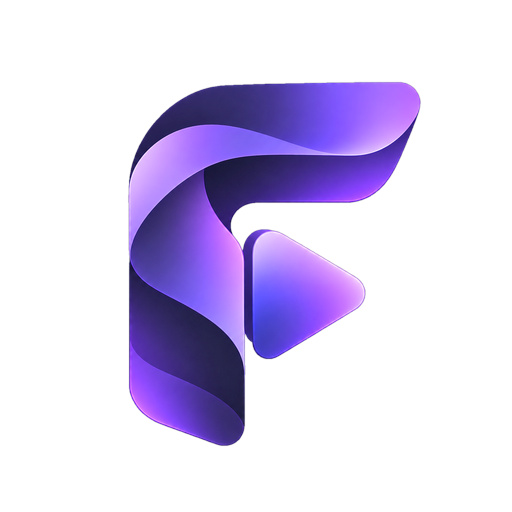

<div align="center">

  

  <h3>Flixio</h3>
  <p>Open-source media catalog and dual-engine player for Android, built with Kotlin Multiplatform and Compose Multiplatform.</p>

  <p>
    <a href="https://flixio.antideploy.app/">
      
    </a>
    <a href="https://discord.gg/dDMMeq338K">
      
    </a>
    <a href="https://github.com/VivxKumar07/Flixio/releases/latest">
      
    </a>
    <a href="./LICENSE">
      
    </a>
    <a href="https://developer.android.com/">
      
    </a>
  </p>

  <p>
    <a href="https://flixio.antideploy.app/">Website</a> •
    <a href="https://discord.gg/dDMMeq338K">Discord</a> •
    <a href="#overview">Overview</a> •
    <a href="#whats-different-in-flixio">What's Different</a> •
    <a href="#features">Features</a> •
    <a href="#download">Download</a> •
    <a href="#building-from-source">Build</a> •
    <a href="#credits--licenses">Credits & Licenses</a>
  </p>

</div>

---

## Overview

**Flixio** is an Android-first fork of [Nuvio Mobile](https://github.com/NuvioMedia/NuvioMobile) built with **Kotlin Multiplatform** and **Compose Multiplatform**.

Most media apps force you to pick between Stremio's addon ecosystem or CloudStream's `.cs3` providers. Flixio brings **Stremio v3 addons**, **CloudStream 3 providers**, **Nuvio JS plugins**, and **Debrid resolvers** into one player, paired with dual playback engines (Media3 ExoPlayer + `libmpv`), built-in DNS-over-HTTPS, and multi-device sync.

> [!NOTE]
> **Flixio does not host, bundle, index, or distribute any media content or scraping providers.** It is a frontend player and catalog organizer that only plays streams returned by addons or providers you explicitly configure.

---

## What's Different in Flixio

Flixio builds on [Nuvio Mobile](https://github.com/NuvioMedia/NuvioMobile) with the following changes and additions:

- **Visual & Navigation Polish**: Reworked home header (time-based greeting), stabilized hero carousel sizing, floating blurred bottom navigation bar, and a 2-column discovery category grid.
- **Player Gestures & Audio**: Left-side vertical swipe for volume (with boost up to 150%), right-side vertical swipe for brightness, horizontal scrubbing, and glassmorphic HUD overlays.
- **Subtitles & Custom Fonts**: Added weight/family presets and a local `.ttf` / `.otf` custom font importer on Android, alongside `libass` ASS/SSA rendering.
- **CloudStream & Plugins Support**: Integrated `.cs3` provider compatibility and link extraction alongside Stremio v3 manifests and Nuvio JS plugins.
- **Tracking & Sync**: Native MDBList integration alongside Trakt and Simkl, plus two-way Supabase sync for watch history, continue-watching progress, and profiles.
- **Telegram Integration (WIP)**: Built-in TDLib client and local HTTP range server for streaming media from your joined Telegram chats.

---

## Features

### Addons, Providers & Networking
- **Stremio v3 Addons**: Supports catalog, meta, stream, and subtitle endpoints from community Stremio manifests.
- **CloudStream 3 (`.cs3`) & Nuvio Plugins**: Load community repositories and extract direct links in-app.
- **Debrid Resolvers**: Supports Real-Debrid, AllDebrid, TorBox, Premiumize, and Debrid-Link.
- **Built-in DNS-over-HTTPS (DoH)**: Resolves addon and scraper requests over encrypted DNS without needing a separate VPN app.

### Playback & Subtitles
- **Dual Player Engine**: Switch between **AndroidX Media3 (ExoPlayer)** and **`libmpv`** depending on device hardware and codec needs.
- **Subtitle Support**: Embedded tracks, external SRT/VTT, styled ASS/SSA (`libass`), timing offset adjustment, and custom `.ttf`/`.otf` fonts.
- **Playback Tools**: Auto-play next episode, episode drawer, `0.25x`–`3.0x` playback speed, IntroDB segment skipping, and Picture-in-Picture (PiP).

### Discovery, Profiles & Sync
- **Multi-Profile Support**: Separate libraries and watch histories per profile.
- **Cross-Device Sync**: Two-way progress and library synchronization via Supabase.
- **Scrobbling & Lists**: Trakt, Simkl, and MDBList support.

---

## Download

Pre-built APKs are available on the [**Official Website**](https://flixio.antideploy.app/) and the [**GitHub Releases**](https://github.com/VivxKumar07/Flixio/releases) page:

| Variant | Package | Target Devices |
|:---|:---|:---|
| **ARM64-v8a** *(Recommended)* | `androidApp-full-arm64-v8a-release.apk` | Modern Android phones & tablets (Android 7.0+) |
| **ARMv7a** | `androidApp-full-armeabi-v7a-release.apk` | Older 32-bit Android phones & TV boxes |
| **x86_64** | `androidApp-full-x86_64-release.apk` | Emulators, Chromebooks & WSA |
| **Universal** | `androidApp-full-universal-release.apk` | Contains all ABIs if unsure which architecture you need |

---

## Platform Status

- **Android (Primary Target)**: Actively developed and tested on Android 7.0 (API 24) through Android 15 (API 35).
- **iOS**: Source sets and GitHub Actions workflow (`iosApp/`) are present in the repository for experimental/sideload builds, though Android remains the primary focus.

---

## Building from Source

### Prerequisites
- **JDK 17** or newer
- **Android SDK** (API 35)

### Clone & Build
```bash
git clone https://github.com/VivxKumar07/Flixio.git
cd Flixio
```

Optional environment configuration in `local.properties` (if connecting your own Supabase or tracking keys):
```properties
FLIXIO_SUPABASE_URL=https://your-project.supabase.co
FLIXIO_SUPABASE_ANON_KEY=your_supabase_anon_key
FLIXIO_ANDROID_DISTRIBUTION=full
```

Build the Android debug APK:
```bash
# Linux / macOS
./gradlew :androidApp:assembleFullDebug "-Pflixio.android.distribution=full" --no-configuration-cache

# Windows (PowerShell)
.\gradlew :androidApp:assembleFullDebug "-Pflixio.android.distribution=full" --no-configuration-cache
```

Output path:
```text
androidApp/build/outputs/apk/full/debug/androidApp-full-debug.apk
```

---

## Contributing

Bug reports, issue triage, and pull requests are welcome. Please read [CONTRIBUTING.md](./CONTRIBUTING.md) before opening a PR.

Maintained by **Vivek Kumar** ([@VivxKumar07](https://github.com/VivxKumar07)).

---

## Credits & Licenses

Flixio is licensed under the **GNU General Public License v3.0 (GPLv3)** — see [LICENSE](./LICENSE).

In compliance with GPLv3 and open-source licensing terms, Flixio acknowledges and builds upon the following projects:

### Core Upstream & Runtimes
| Project | Role in Flixio | License |
|:---|:---|:---|
| [Nuvio Mobile](https://github.com/NuvioMedia/NuvioMobile) | Upstream application codebase & architecture | GPLv3 |
| [CloudStream 3](https://github.com/recloudstream/cloudstream) | `.cs3` plugin compatibility layer (`com.lagradost.cloudstream3`) | GPLv3 |
| [TDLib](https://github.com/tdlib/td) | Telegram client library | Boost Software License 1.0 |

### Playback, UI & Infrastructure Libraries
| Library | Purpose | License |
|:---|:---|:---|
| [AndroidX Media3 (ExoPlayer)](https://developer.android.com/media/media3) | Primary Android media playback engine | Apache 2.0 |
| [mpv-android](https://github.com/mpv-android/mpv-android) / [MPVKit](https://github.com/mpvkit/MPVKit) | Secondary `libmpv` playback engine | GPLv2+ / LGPLv2.1+ |
| [libass-android (ass-media)](https://github.com/peerless2012/ass-media) | ASS/SSA subtitle rendering | MIT / ISC |
| [quickjs-kt](https://github.com/aspect-build) | Embedded JavaScript runtime for plugins | MIT |
| [Haze](https://github.com/chrisbanes/haze) | Blur and glassmorphism effects | Apache 2.0 |
| [Coil 3](https://coil-kt.github.io/coil/) | Image loading & caching | Apache 2.0 |
| [Ktor](https://ktor.io/) & [OkHttp](https://square.github.io/okhttp/) | HTTP networking & DoH | Apache 2.0 |
| [Supabase Kotlin](https://github.com/supabase-community/supabase-kt) | Auth, database & storage sync | MIT |
| [Kermit](https://github.com/touchlab/Kermit) & [Sentry](https://sentry.io/) | Logging & crash diagnostics | Apache 2.0 / MIT |

### Metadata & Tracking Services
- [TMDB](https://www.themoviedb.org/) — Metadata & artwork (Flixio uses the TMDB API but is not endorsed or certified by TMDB)
- [IMDb Non-Commercial Datasets](https://developer.imdb.com/non-commercial-datasets/) — Identifier & dataset support
- [Trakt](https://trakt.tv/), [Simkl](https://simkl.com/), [MDBList](https://mdblist.com/) — Watchlist & scrobbling
- [IntroDB](https://introdb.app/) — Community intro/outro segment timestamps

Full third-party notices and attributions are also viewable inside the app under **Settings → About → Licenses & Attributions**.

---

## Disclaimer

Flixio is an open-source media player and catalog client. It does not host, upload, index, or stream any copyrighted content. Users are solely responsible for the addons, repositories, and media sources they choose to add and access.
